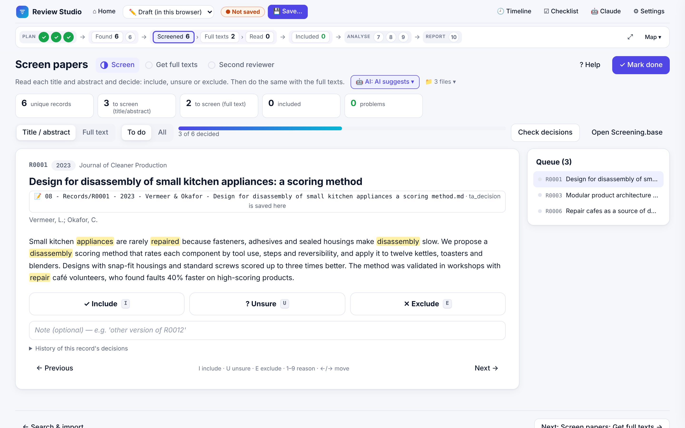
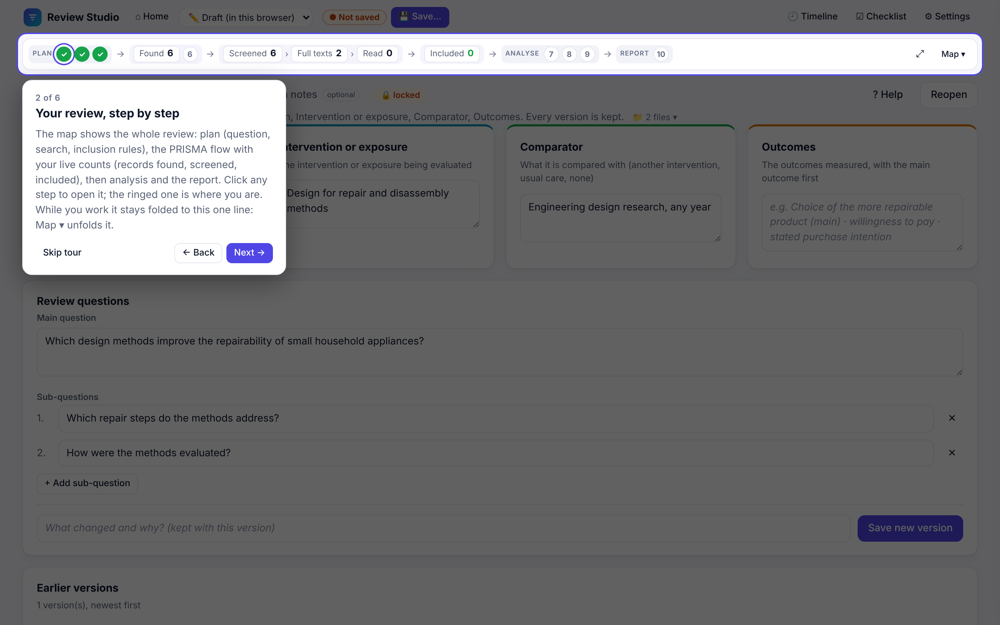

# Review Studio

**A workbench for systematic reviews, reported to PRISMA 2020, that runs in your browser and keeps every review in a folder on your own PC. Scoping reviews (PRISMA-ScR) are supported too. The methods follow Cochrane and JBI guidance.**

**[▶ Open it in your browser](https://abdulhamid-baghdadi.github.io/review-studio/)** · **[💾 Download for Windows, Mac and Linux](https://github.com/Abdulhamid-Baghdadi/review-studio/releases/latest/download/review-studio.zip)** · Chrome or Edge on a computer

Review Studio walks you through a systematic review from the first idea to the PRISMA flow diagram: questions, search strings, protocol, database imports, screening, full texts, charting and the report. Your review is a plain folder of Markdown notes, CSV tables and PDFs: nothing is uploaded, there is no account, and the folder opens in Obsidian or any text editor.



*Screening in Review Studio (example data). Search terms are highlighted in the abstract; I / U / E decide.*



*The 1-minute app tour, started from the Homepage.*

**Highlights**

- 🧭 **Guided, step by step:** 10 steps from idea to report, each with what to do, where it is saved, and help with a worked example.
- 🔒 **Your files, your PC:** no account, no upload, no database. A review is a folder of Markdown, CSV and PDFs.
- 🟣 **Opens in Obsidian:** a review folder is an Obsidian vault as it is, with the screening and charting tables as `.base` files.
- 🤖 **AI only if you want it:** Claude can pre-screen, fetch PDFs, be the blind second reviewer or prefill charting. It suggests; you confirm.
- 📶 **Works offline** once opened, or install it as an app.

## Contents

- [Getting started](#getting-started)
- [Three ways to use it](#three-ways-to-use-it)
- [The 10 steps](#the-10-steps)
- [Your review folder](#your-review-folder)
- [AI assistance with Claude (optional)](#ai-assistance-with-claude-optional)
- [Privacy and data safety](#privacy-and-data-safety)
- [Questions and problems](#questions-and-problems)
- [For developers](#for-developers)

## Getting started

1. Open **https://abdulhamid-baghdadi.github.io/review-studio/** in **Chrome or Edge** on a computer.
2. You start on the **Homepage**: a one-minute animated walk through a review, and the **🎓 tour** of the screen.
3. Pick a step in the map at the top of the page. Your work starts as **My review**, kept in the browser, so you can begin with your idea and research questions right away. There is no Save button: everything you type is saved as you go (*✓ Saved* in the top bar).
4. To keep it as files on your PC, open the review menu (top left, next to the logo) → **💾 Save my review to a folder…**, give it a name and pick a place. From then on every change is written to that folder. Once the protocol is locked, a change to it is an amendment: those fields save when you leave them and ask for the reason.
5. Next time, the same bar offers **📂 Open a review folder…** and your recent reviews. The browser asks once per visit before the app may edit a folder.

Handy: **⌂ Home** (top left) explains the app and offers three ways in: start or continue your review, see the finished example, or take the tour. The map under the top bar is folded to one line while you work (**Map ▾** unfolds it); **⚙ Settings** has light/dark, the glossary and the keyboard shortcuts.

## Three ways to use it

| | How | Good for |
|---|---|---|
| 🌐 **In the browser** | Open the [website](https://abdulhamid-baghdadi.github.io/review-studio/). | Trying it, everyday use. Always the newest version. |
| 📲 **As an app** | On the website: **⚙ Settings → ⬇ Install as an app** (or the install icon in the address bar). | Its own window and Start-menu icon; works offline; updates itself. |
| 💾 **On your own computer** | [Download the ZIP](https://github.com/Abdulhamid-Baghdadi/review-studio/releases/latest/download/review-studio.zip) and double-click the launcher (below). | Working without the website, keeping a fixed version, using Claude Code with the AI skills, or changing the code. |

### Running the download

You need **[Node.js](https://nodejs.org) 20 or newer** (free; install it once) and **Chrome or Edge**. Unzip the download, then:

| System | Double-click | Notes |
|---|---|---|
| **Windows** | `Start Review Studio.cmd` | If Windows SmartScreen warns, choose *More info → Run anyway*. |
| **Mac** | `Start Review Studio.command` | The first time macOS may block it: **right-click → Open → Open**. |
| **Linux** | `start-review-studio.sh` | Or run `./start-review-studio.sh` in a terminal (if needed: `chmod +x start-review-studio.sh`). |

The launcher starts the app on your computer and opens it at **http://localhost:8770/web/**. Keep its window open while you work; close it (or press Ctrl+C) to stop. Your reviews are not inside the app's folder: they are wherever you saved them, so you can replace the app with a newer download at any time.

## The 10 steps

A new review is a **systematic review, reported to PRISMA 2020**. A map at the top of every page shows the ten steps in plain words; steps with more than one part show them as tabs on their page.

| # | Step | Tabs | What you do |
|---:|---|---|---|
| 1 | **Research question** | Question · Idea notes *(optional)* | Say exactly what you want to find out, as PICO (Population, Intervention, Comparator, Outcomes); jot down early ideas with dates. Every version is kept. |
| 2 | **Search strategy** | Keywords · Search strings · Test the search *(optional)* | One block of synonyms per idea in your question; ready-to-paste strings per database (Scopus, Web of Science, IEEE Xplore, OpenAlex, …); trial runs against papers you already know. |
| 3 | **Inclusion rules** | Include / exclude rules · Other methods · Lock & register | Which studies are in and which are out, with the exclusion reasons (E1, E2 …) used while screening; the other protocol sections; freeze the plan before searching. |
| 4 | **Search & import** | | Import each export (RIS, BibTeX, CSV) with its exact string and date; duplicates are merged. |
| 5 | **Screen papers** | Screen · Get full texts · Second reviewer | Title/abstract, then full text, with keyboard shortcuts; find and attach the PDFs; a blind second reviewer, with Cohen's κ. |
| 6 | **Citation search** *(optional)* | | Follow the references of included studies until a round adds nothing new (snowballing). |
| 7 | **Extract data** | | The extraction form for every included study, with page numbers. |
| 8 | **Risk of bias** | | How trustworthy each study is, with a tool such as RoB 2 or ROBINS-I. |
| 9 | **Synthesis** | | Narrative synthesis or meta-analysis (forest and funnel plots, R script) and the certainty of the evidence (GRADE). |
| 10 | **Report** | | PRISMA flow diagram, PRISMA 2020 checklist, report draft and exports. |

**The map is the navigation.** Folded to one slim line by default (numbered steps and the PRISMA counts), or unfolded with *Map ▾*. It runs from the planning steps through the boxes of the PRISMA flow diagram, with your live counts (records found, titles and abstracts screened, full texts sought and read, studies included), to the analysis steps and the report. *You are here* marks the page on screen; click any box to open it, or ⤢ for the full PRISMA diagram.

**A finished example.** [Open it directly](https://abdulhamid-baghdadi.github.io/review-studio/web/#example) (the link `…/web/#example`), or click *Open the example* on the Homepage or *📘 Show me an example* at the top of any page. It is a small systematic review, finished up to the report: *Do sit-stand desks reduce sitting time at work?* A real OpenAlex search (66 records, string and date logged) is screened down to 8 randomised trials, read in full, with data extracted (page and table for each value), risk of bias judged with RoB 2, a random-effects meta-analysis of 7 trials (forest and funnel plot, R script) and GRADE. The open-access full texts come with it; papers without an open licence are marked "not retrieved" (sources and licences: `web/example/full-texts/LICENSES.md`). The example is copied fresh into the browser each time it is opened, so visitors can change anything; **💾 Save a copy…** puts the whole review (notes and PDFs) in a folder on your PC, ready to open in Obsidian. It is built by `npm run example` from the saved search in `web/example/openalex-search.json`. The judgements were made for this teaching example by one reviewer.

**Scoping reviews** (reported to PRISMA-ScR) are still supported: switch a review under ⚙ Settings → *Review type*. A scoping review uses Population–Concept–Context, calls step 7 *Chart the data* and step 8 an optional *Quality check*, and has no synthesis step. Reviews made before review types existed open as scoping reviews.

Links to a part of the app keep working: `…/web/#questions` opens the Question tab, `#protocol` the inclusion rules, `#screening` screening.

Keyboard shortcuts while screening: **I** include · **U** unsure · **E** exclude · **1–9** reason · **← / →** previous / next.

## Your review folder

A review is one folder named `<review name> records`:

```
Project 2 review records/
├── 00 - Review log.md          every action, dated
├── 00 - Review timeline.md     the review's history in one note
├── 03 - Search strategy.md
├── 05 - Protocol.md
├── 07 - Searches.csv           one row per search: database, string, date, counts
├── 07 - Exports/               the original database exports
├── 08 - Records/               one Markdown note per paper (R0001 - 2024 - Liu et al. - ….md)
├── 08 - Screening guide.md     eligibility criteria and exclusion reasons
├── 09 - Second reviewer/       blind sample sheets (CSV)
├── 10 - Full texts/            the PDFs, named after their record
├── 14 - PRISMA flow.md
├── 14 - PRISMA-ScR checklist.md
└── review_state.json           stages, protocol, settings
```

Each record note keeps its decisions in its properties, in full words (`title_abstract_decision`, `full_text_decision`, `full_text_status`, `extracted_<field>`, …), with the properties it shares with a library's publication notes first (`title`, `authors`, `year`, `journal`, `doi`, `url`, `openalex`), so you can also browse and filter the review in Obsidian. Reviews made with the older short names (`ta_decision` …) are upgraded the first time they are opened. *Settings → Review settings* links the folder to your Obsidian vault, so notes open there with one click.

## Traceability

- **Decision log.** Every change of a screening decision (title/abstract, full text, second reviewer) is a row in `08 - Decision log.csv`: when, old → new decision, reason, who (your initials, set in *Settings → Review settings*) and how (by hand, a reviewed AI suggestion, a rule, an imported sheet, or an edit outside the app such as in Obsidian). Each row's SHA-256 covers the row before it, so an edited or deleted row shows: *Report → Check the decision log*. Each record shows its own history under the screening buttons.
- **Export to your Obsidian library.** *Report → Export to Obsidian library* turns the included papers into publication notes in your library folder, from your own publication template (⚙ Settings → Review settings → *Publication template*; otherwise the app's own), with `added_by` (the review) and `added_on` (the date), copies their PDFs (to the folder you chose, else `PDFs` in the library folder), and then updates the citations below. A paper already in the library only gets the review added to `included_in`.
- **Citations in your library.** *Report → Check citations* looks up the papers of your publication library on OpenAlex (by DOI, about one request per 50 papers) and writes what each paper cites into `cites`: a link for a paper in your library, otherwise its DOI (or its OpenAlex id when it has none) (for Obsidian's graph; the papers citing a paper are its backlinks). Run it again after adding papers and the DOIs of papers now in your library become links. The old `cited_by` property and *Unlinked cited works* section are removed. It shows what would change first; nothing else in the notes is touched. (This used to be Library Studio's Citations page.)
- **Review package.** *Report → Make review package* writes `07 - Exports/Review package <date>/` and the same as a ZIP: the registered and current protocol, timeline and amendments, search strings and export files, every decision with its reason, the decision log, the second-reviewer sheets, the charting or extraction table, the flow diagram, the checklist and a report on AI use. `MANIFEST.md` lists the SHA-256 of every file, so a copy deposited on OSF or Zenodo can be checked.

## AI assistance with Claude (optional)

Each step that can use help has an **🤖 AI assistance** card where you choose whether to use it. It is off by default. When it's on, [Claude Code](https://claude.com/claude-code) can:

- **pre-screen** titles and abstracts, or full texts, and suggest a decision with a reason;
- **fetch full texts** (open access first) and attach the PDFs;
- act as a **blind second reviewer** on the sample;
- **prefill the charting form** (data extraction in a systematic review) from the PDFs, with page locators;
- **suggest appraisal or risk-of-bias ratings** with the tool you chose (e.g. RoB 2), with reasons and page locators.

Claude only ever *suggests*: you confirm or change every suggestion in Review Studio, each AI action is logged with the model and date, and the protocol's "Use of AI assistance" section is written for you.

How to use it: open the app's folder (the download, or a clone of this repository) in Claude Code, press **📋 Copy prompt** on the AI card and paste it. The skills are in `.claude/skills/`; they work through `node bin/ai-assist.js`, which refuses whenever the review has the AI switched off for that step. Keep Review Studio open next to it: it notices Claude's changes and shows them.

## Privacy and data safety

- **Nothing leaves your PC.** The app is a static web page; your review folder is read and written by your own browser. The only network requests are searches you start yourself (OpenAlex) and loading the app.
- **Your files stay readable.** Plain Markdown, CSV and JSON: no database, no lock-in.
- **Edits made elsewhere are kept.** If you change a note in Obsidian while the app is open, saving that record in the app keeps your edit. If Claude changes the review, the app re-reads it.
- **Tip:** keep the review folder under version control (git) or in a synced folder, so you can always go back.

## Questions and problems

- **"Open a review folder" does nothing / is missing.** Use Chrome or Edge in a normal window on a computer. Firefox, Safari, phones and browser panes inside other apps cannot open folders.
- **The launcher says Node.js is needed.** Install it from https://nodejs.org (the LTS version) and start the launcher again.
- **Port 8770 is already in use.** The app is probably already running: open http://localhost:8770/web/, or close the other launcher window.
- **I don't see the newest version.** The app stores itself for offline use and updates on the next visit; reload the page once more.
- **Something else?** [Open an issue](https://github.com/Abdulhamid-Baghdadi/review-studio/issues).

## For developers

Run from a clone with `npm install` and `npm run serve` (then open http://localhost:8770/web/), or with the launchers above.

Plain JavaScript (ES modules), no framework and no bundler; the only dependency is [pdf.js](https://mozilla.github.io/pdf.js/) for reading PDFs. The code is split into layers (domain rules, ports, services, adapters, UI). See [ARCHITECTURE.md](ARCHITECTURE.md).

```
npm test                 # unit tests
npm run check            # architecture: each layer imports only what it may
npm run build            # the static site in dist/
node scripts/bench-open.js "<copy of a … records folder>"   # how fast a review opens
node scripts/readme-screenshot.js   # docs/screenshot.png and docs/tour.png, with example data (needs npm run serve)
```

Every push to `main` is tested, built and published on GitHub Pages, and the download ZIP on the [latest release](https://github.com/Abdulhamid-Baghdadi/review-studio/releases/latest) is rebuilt (`.github/workflows/pages.yml`). Review data is never part of this repository.
